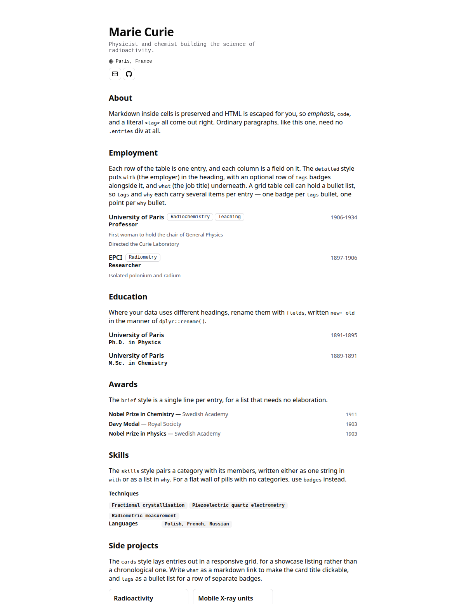

# Jarocki CV

A Quarto HTML format for writing a CV in the minimalist, print-friendly style
of [cv](https://github.com/BartoszJarocki/cv) by Bartosz Jarocki: a single
column, a monospace accent, and a design meant to be read equally well on
screen and on paper. CV entries are written as tables, either by hand or
generated by code.

<table>
<tr>
<td width="320"></td>
<td><code>format: jarocki-html</code><br>A single column with a monospace accent, built from headings and <code>.entries</code> tables in the <code>detailed</code>, <code>brief</code>, <code>skills</code>, <code>badges</code> and <code>cards</code> styles, with contact buttons that become plain text when printed.</td>
</tr>
</table>

## Installing

```bash
quarto use template quarto-vitae/jarocki
```

This installs the extension and creates a starting `template.qmd`. To add the
format to a document you already have, use `quarto add quarto-vitae/jarocki`.

Nothing beyond Quarto itself is required to render: there is no LaTeX, no
Node, and no build step. Output is a single, self-contained HTML page.

## Using

Set the format and describe yourself in the YAML header:

```yaml
---
name: Marie
surname: Curie
position: "Physicist and chemist building the science of radioactivity."
social:
  - address: "Paris, France"
  - email: marie.curie@example.org
  - github: mcurie
format: jarocki-html
---
```

Write each section as a heading, and each listing as a table inside an
`.entries` div. One row becomes one entry, and one column becomes one field on
it, named by its heading:

```markdown
# Employment

::: {.entries style="detailed"}
| what      | with                 | when      |
|-----------|----------------------|-----------|
| Professor | University of Paris  | 1906-1934 |
:::
```

Where your data uses different headings, rename them with `fields`, written
`new: old` in the manner of `dplyr::rename()`:

```markdown
::: {.entries style="detailed" fields="{what: Degree, with: Institution, when: Years}"}
```

Markdown inside table cells is preserved, so `**bold**`, `*italic*` and links
all work, and HTML special characters are escaped for you exactly once. Write
`with` as a markdown link — `[Motion](https://motionapp.com/)` — to make an
employer or institution clickable.

### Printing to PDF

The design is print-friendly by construction: open the rendered page in a
browser and use its print command (Ctrl/Cmd+P) to save it as a PDF. A
dedicated print stylesheet hides the on-screen contact buttons in favour of a
plain text contact line, disables the entrance animation, and tightens
spacing to fit more on the page.

### Entries from code

More often the data lives in a data frame, and the same options are given as
cell options. The cell prints a table and the filter picks it up:

````markdown
```{r}
#| echo: false
#| vitae:
#|   style: detailed
#|   fields:
#|     what: title
#|     with: company
#|     when: years
work |> filter(current)
```
````

Entries can also come from a CSV printed by a cell, from several tables in one
div, or carry bullet lists written in grid table cells. Those are covered in
the [vitae documentation](https://quarto-vitae.github.io/).

## Styles

This format implements the three conventional vitae listing styles, plus two
of its own for the shapes this design is built around.

`detailed`
: A heading (`with` — the employer or institution), with an optional row of
  `tags` badges inline beside it, a subheading (`what` — the job title or
  degree), a right-aligned `when`, and a bulleted elaboration built from
  `why`. Suits employment and education. This is the style used when none is
  given.

`brief`
: A single line per entry, from `what` (bold), `where` (falling back to
  `with`), and a right-aligned `when`. Suits awards, memberships and service.

`skills`
: A category in `what` paired with its members, given either as one string
  in `with` or as a list of badges in `why`.

`badges`
: A flat, wrapped wall of pill badges, one per entry's `what`. For a flat
  skills list with no categories.

`cards`
: A responsive grid of cards, from `what` (the title — write it as a markdown
  link to make the card clickable), `why` (a short description) and `tags`
  (technologies, as a wrapped row of outline badges). Suits side projects and
  similar showcase listings.

### The `tags` field

Beyond the five conventional fields, `detailed` and `cards` both recognise an
extra `tags` column: a row of outline badges — inline beside the heading in
`detailed`, below the description in `cards` — for the technologies used in a
role or a project.

Each item becomes its own badge, spaced by CSS `gap` rather than a printed
separator, so there is nothing to join or strip and any number of tags lines
up cleanly. Give `tags` several items the same way you would give `why`
several items — whichever reads best in the table:

- a grid table cell holding a bullet list (see `template.qmd`)
- several rows collapsed with `collapse="tags"`
- several columns mapped onto one field: `fields="{tags: [tech1, tech2]}"`

A plain string (`tags: "React, TypeScript"`) is valid too, but renders as a
*single* badge containing that whole string — use one of the above when you
want it split into separate pills.

## Format options

Set these in the YAML header. All are optional except `name`.

### Header contents

| Option | Effect |
|--------|--------|
| `name`, `surname` | The name shown in the header |
| `position` | A tagline under the name |
| `social` | Contact details as a list of `service: handle` items, shown in the order written. The address is shown under the position; every other item becomes an icon button on screen and plain text when printed. Email, phone, website, GitHub, LinkedIn and X have their own icons, and any other service gets a generic link icon. Shared by every quarto-vitae template. |
| `profilepic` | Path to a square profile image |
| `initials` | Shown in a placeholder avatar when `profilepic` is not set |
| `description` | Overrides the `<meta name="description">` tag; defaults to `position` |

### Typography

| Option | Effect |
|--------|--------|
| `mainfont` | Body font, as a CSS `font-family` value. Defaults to the system UI font. |
| `monofont` | Monospace accent font, used for the tagline, dates and badges. Defaults to the system monospace font. |

```yaml
mainfont: "'Inter', sans-serif"
monofont: "'JetBrains Mono', monospace"
```

## Licensing

Released under the MIT licence, see [LICENSE](LICENSE.md). Built on
[cv](https://github.com/BartoszJarocki/cv) by Bartosz Jarocki.

---

> [!TIP]
> **This is one of several vitae templates for Quarto.**
>
> They share the same entry syntax, so a CV written here can be rendered with a
> different design by changing the `format:` line. To browse the other
> templates, read the full guide to writing a CV, or build a template of your
> own, visit <https://quarto-vitae.github.io/>.
